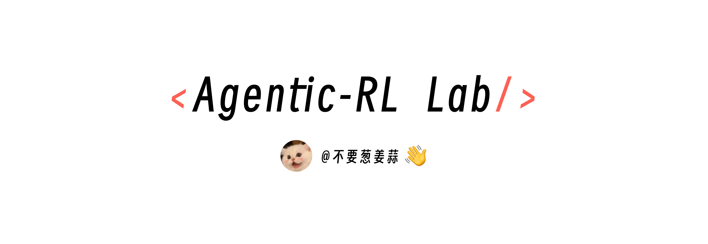

<div align="center">



# Agentic RL Lab · 本地 GPU 版

**把 [Datawhale Agentic RL Lab](https://github.com/datawhalechina/agentic-rl-lab) 的 16 篇实验，从 PyTRIO 云端搬到自己的 4×A6000 上。**

📖 在线阅读：<https://hxusz11.github.io/Agentic_RL/>

</div>

## 这是什么

原教程用 [PyTRIO](https://pytrio.com) 把训练和采样交给云端，本地只写数据、reward 和训练循环。本仓库保留全部算法讲解和实验代码，用 **[localtrio](./localtrio)** 替换云端：

- **接口不变**：`ServiceClient`、`create_lora_training_client`、`forward_backward(_custom)`、`optim_step`、`save_weights_and_get_sampling_client`、`sample`、`compute_logprobs` 与 PyTRIO 0.2.9 同名同参，训练循环代码基本只需把 `import pytrio as trio` 换成 `import localtrio as trio`；评测端点、`trio://` 路径和多基模 GPU 布局按[迁移指南](./docs/content/guide/localtrio.md#从-pytrio-代码迁移)调整。
- **训练**：HF transformers + PEFT LoRA（bf16 基模、fp32 LoRA/AdamW、梯度检查点、分块 logprob），支持 Qwen3.5 的线性注意力层与图文输入。
- **采样**：vLLM（AsyncLLM 连续批处理，每卡一个副本），每个 step 的 LoRA 权重热加载，logprob 与训练端同口径。
- **checkpoint**：本地目录、标准 PEFT 格式，可直接 `vllm serve`、合并导出。

```text
GPU0  训练（transformers + PEFT）
GPU1  vLLM 采样副本 #1  ┐
GPU2  vLLM 采样副本 #2  ├ 同一基模的所有 LoRA（学生各 step、SFT 教师）共用
GPU3  vLLM 采样副本 #3  ┘
```

## 快速开始

```bash
git clone https://github.com/HXuSz11/Agentic_RL.git
cd Agentic_RL
uv sync                      # torch / transformers / peft / vllm / 实验依赖
uv sync --extra kernels      # 推荐：Qwen3.5 线性注意力训练 kernel
uv run python -m localtrio info
uv run python scripts/gpu_smoke_test.py   # 第一次在 GPU 上运行前的自检（vLLM 采样 / 训练 logprob 一致性 / LoRA 热加载）
uv run python experiments/grpo/01-demo-sync.py --steps 2 --batch-size 4 --group-size 4 \
    --max-tokens 512 --swanlab-mode disabled
```

需要 Linux x86_64 和 NVIDIA 驱动 ≥ 580（`uv.lock` 锁定的 torch 2.14 / vLLM 0.33 基于 CUDA 13.0）。`uv sync` 默认精确同步，会卸载这次命令没写上的 extra：之后再装 dev / alfworld 时把 kernels 一起写上（如 `uv sync --extra kernels --extra alfworld`），或者加 `--inexact`，详见[安装说明](./docs/content/guide/quickstart.md#获取代码与安装依赖)。

更多：[安装与第一个实验](./docs/content/guide/quickstart.md) · [localtrio 原理与 API 对照](./docs/content/guide/localtrio.md) · [4×A6000 显存与 GPU 布局](./docs/content/guide/hardware.md)

## GPU 布局预设

| 预设 | 布局 | 用于 |
| --- | --- | --- |
| 默认 / [`configs/4xa6000.yaml`](./configs/4xa6000.yaml) | GPU0 训练，GPU1-3 采样 | 除 General OPD 外的全部 4B 章节 |
| [`configs/4xa6000-opd-27b.yaml`](./configs/4xa6000-opd-27b.yaml) | GPU0 训练，GPU1 学生采样，GPU2-3 27B 教师（TP=2） | General OPD |
| [`configs/4xa6000-big-student.yaml`](./configs/4xa6000-big-student.yaml) | GPU0-1 训练，GPU2-3 采样 | 9B 学生 |
| [`configs/1gpu.yaml`](./configs/1gpu.yaml) | 训练与采样共用 GPU0 | 单卡 |
| [`configs/cpu-debug.yaml`](./configs/cpu-debug.yaml) | CPU + HF 采样 | 代码调试 |

用法：`LOCALTRIO_CONFIG=configs/<预设>.yaml uv run python ...`

## 实验目录

| # | 实验 | 内容 | 快速启动 |
| --- | --- | --- | --- |
| 01 | [Loss Functions](./experiments/loss-functions/readme.md) | importance sampling、PPO、CISPO 在优化什么 | — |
| 02 | [GRPO](./experiments/grpo/readme.md) | GSM8K 上的 GRPO，比较三种 loss | [运行](./experiments/grpo/start.md) |
| 03 | [Vision GRPO](./experiments/vision-grpo/readme.md) | GeoQA 图文推理 | [运行](./experiments/vision-grpo/start.md) |
| 04 | [Jev 决策模型](./experiments/pytrio-jev/readme.md) | LoRA 分类决策、受限 softmax 与温度校准 | [运行](./experiments/pytrio-jev/start.md) |
| 05 | [General OPD](./experiments/general-opd/readme.md) | 学生采样、27B 教师打分与 reverse KL | — |
| 06 | [Medical OPD](./experiments/medical-opd/readme.md) | SAR-OPD、IDT-OPD 与多教师 | [运行](./experiments/medical-opd/start.md) |
| 07 | [DAPO](./experiments/dapo/readme.md) | 四项改进与 Dynamic Sampling 的成本 | [运行](./experiments/dapo/start.md) |
| 08 | [GSPO](./experiments/gspo/readme.md) | 序列级重要性比率与裁剪 | [运行](./experiments/gspo/start.md) |
| 09 | [OPSD](./experiments/opsd/readme.md) | 固定 step-0 教师的自蒸馏 | [运行](./experiments/opsd/start.md) |
| 10 | [AgentOPSD](./experiments/agentopsd/readme.md) | Self-Teacher 的 turn-level 信用分配 | [运行](./experiments/agentopsd/start.md) |
| 11 | [Search-R1](./experiments/search-r1/readme.md) | 多轮搜索 RL | [运行](./experiments/search-r1/start.md) |
| 12 | [ReTool](./experiments/retool/readme.md) | 代码沙箱交织的 Agentic RL | [运行](./experiments/retool/start.md) |
| 13 | [ALFWorld](./experiments/alfworld/readme.md) | TextWorld 家务 Agent 与长轨迹 | [运行](./experiments/alfworld/start.md) |
| 14 | [TEMPO](./experiments/tempo/readme.md) | macro-step 优化与生成式 critic | — |
| 15 | [Spec-o3](./experiments/spec-o3/readme.md) | 光谱图像 + 工具调用的 SFT 与 GRPO | [运行](./experiments/spec-o3/start.md) |
| 16 | [Tournament-GRPO](./experiments/tournament-grpo/readme.md) | 研究报告淘汰赛奖励 | [运行](./experiments/tournament-grpo/start.md) |

## 仓库结构

```text
localtrio/        本地版 Train API（训练引擎、vLLM / HF 采样引擎、子进程 RPC、CLI）
configs/          GPU 布局预设
experiments/      16 个章节：readme.md（文章）、start.md（快速启动）、代码与配图
tests/            localtrio 的 CPU 测试（微型随机 Qwen3 / Qwen3.5-VL 模型）
docs/ scripts/    VitePress 网站（GitHub Pages 自动部署）
```

## 测试与网站

```bash
uv sync --extra kernels --extra dev && uv run pytest tests -q   # localtrio 测试，CPU 即可；extras 写全，避免卸掉 kernels
npm ci && npm run docs:build && npm run docs:check              # 构建并校验网站
npm run docs:dev                                                # 本地预览 http://127.0.0.1:5173/Agentic_RL/
```

网站由 [`.github/workflows/docs.yml`](./.github/workflows/docs.yml) 在默认分支推送后部署。首次使用需要在仓库 **Settings → Pages → Build and deployment → Source** 选择 **GitHub Actions**。

## 已知边界

- localtrio 的训练数学、采样/训练 logprob 一致性、checkpoint 与图文输入在 CPU 微型模型上有测试；**vLLM 后端与各章完整训练尚未在真实 A6000 上实测**，各章“本地资源估算”均为估算值。
- 原文的实验结果与图表来自 PyTRIO 云端，保留并注明来源；本地复现数值可能不同。
- PyTRIO 服务端的数值实现不公开，localtrio 按文档语义复现（loss 归一化口径见 [localtrio 指南](./docs/content/guide/localtrio.md#loss-语义)）。
- 网站目前只有中文版。

## 致谢与许可

- 原教程：[Datawhale Agentic RL Lab](https://github.com/datawhalechina/agentic-rl-lab)，作者 [KMnO4-zx（宋志学）](https://github.com/KMnO4-zx)，内容贡献者 [MRLE](https://github.com/mrle0429)（Tournament-GRPO）。
- 本仓库在 Apache-2.0 许可下修改与再发布，见 [LICENSE](./LICENSE) 与 [NOTICE](./NOTICE)。
