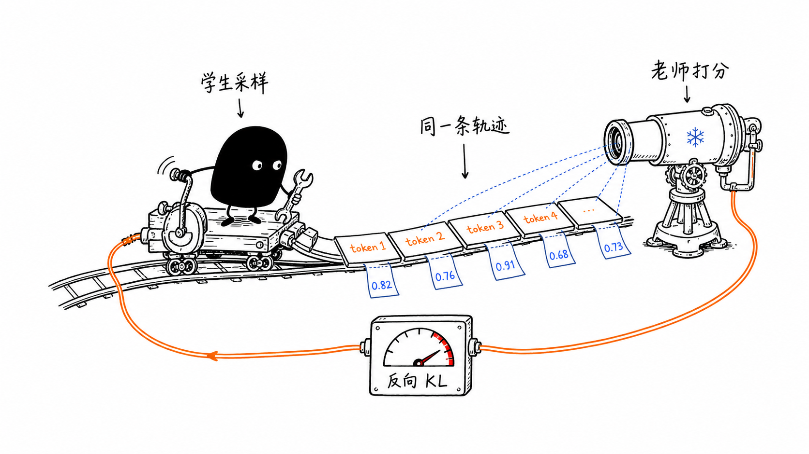

# 通用 On-policy Distillation（OPD）教程


<div align="center">
  <a href="https://www.zhihu.com/people/feng-qi-xia-pian" target="_blank"></a>
  <a href="https://www.xiaohongshu.com/user/profile/63c2055e000000002502c58c" target="_blank"></a>
  <a href="https://github.com/datawhalechina/agentic-rl-lab"></a>
</div>

> **本地 GPU 版说明**
>
> 本章是 Datawhale [开源原教程](https://github.com/datawhalechina/agentic-rl-lab)《通用 On-policy Distillation（OPD）教程》的本地 GPU 版本。代码通过 [localtrio](../../docs/content/guide/localtrio.md)（与 PyTRIO 0.2.9 同名同参的本地实现：训练用 transformers + PEFT LoRA，采样与打分用 vLLM）在你自己的 NVIDIA 显卡上运行：默认 GPU 0 训练 LoRA，其余卡各跑一个 vLLM 采样副本；只有 1 张卡时两者共用。不需要登录、API key，也没有计费。本章的特殊之处是 teacher 与 student 不是同一个基模，teacher 要单独占卡：默认的 27B teacher（bf16 约 54GB）在 48GB 卡上要两张卡做张量并行，4 张 48GB 卡时用预设 [`configs/4gpu-opd-27b.yaml`](../../configs/4gpu-opd-27b.yaml)；卡更少时可以换 9B teacher，80GB 卡上 27B teacher 单卡即可，见[本地运行小节](#在本地运行同步版-demo)。原文的实验在 PyTRIO 云端完成，本地的硬件、采样引擎和数值精度都不同，且默认不训练输出层 `lm_head`（见本地运行小节“常见问题”里的实现差异说明），复现的数值可能有差异。算法讲解与代码来自原作者，感谢原作者与 Datawhale 社区的开源工作，原文见 [Datawhale 原教程](https://github.com/datawhalechina/agentic-rl-lab)。

> **代码与复现资源**
>
> - 原版开源仓库：[Datawhale 原教程](https://github.com/datawhalechina/agentic-rl-lab)
> - 同步版代码：[01-demo-sync.py](./01-demo-sync.py)
> - 异步版代码：[02-demo-async.py](./02-demo-async.py)
> - 本地运行：[localtrio 原理与 API 对照](../../docs/content/guide/localtrio.md) / [显存与 GPU 布局规划](../../docs/content/guide/hardware.md) / 本文的[本地运行小节](#在本地运行同步版-demo)
> - SwanLab 注册入口：[https://swanlab.cn/login](https://swanlab.cn/login)（训练过程与实验指标记录）
> - DeepMath-103K 数据集：[AI-ModelScope/DeepMath-103K](https://modelscope.cn/datasets/AI-ModelScope/DeepMath-103K)
> - PyTRIO Skill：[SwanHubX/pytrio-skill](https://github.com/SwanHubX/pytrio-skill)（原作者写 demo 时使用；localtrio 与 PyTRIO 接口同名，生成的代码把 import 换成 `import localtrio as trio` 即可本地运行）
> - SwanLab Skill：[SwanHubX/swanlab-skill](https://github.com/SwanHubX/swanlab-skill)

On-policy Distillation（OPD，在线策略蒸馏）可以看作知识蒸馏在自回归生成模型上的一次重要演进。传统蒸馏通常让学生模型学习固定数据或老师预先生成的答案，但学生真正推理时会进入自己的生成分布，训练与推理之间因此容易出现偏移。2023 年的 [Generalized Knowledge Distillation（GKD）](https://arxiv.org/abs/2306.13649) 明确提出让学生在自己生成的序列上接受老师反馈；同一时期的 [MiniLLM](https://arxiv.org/abs/2306.08543) 则系统研究了更适合生成式模型的 reverse KL。今天常说的 OPD，通常就是把这两个关键思想结合起来：轨迹由当前学生生成，老师只负责评价这些轨迹，再用反向 KL 把学生拉向老师。

原文的代码用 [PyTRIO](https://pytrio.cn/) 写成，原因很直接：OPD 最麻烦的地方，是 student 采样之后，还要让 teacher 给同一条 token 轨迹重新打分，而 PyTRIO 提供了 `sample()` 和 `compute_logprobs()` 两个接口。本地版用 [localtrio](../../docs/content/guide/localtrio.md) 实现了同名接口：`sample()` 由 student 的 vLLM 引擎生成，`compute_logprobs()` 用 vLLM 的 `prompt_logprobs` 实现——它不会让 teacher 重新生成答案，而是直接接收 `prompt + student completion` 做一次前向，返回和输入 token 一一对应的 logprobs（原始模型分布，不受采样温度影响）。训练则在 GPU0 上用 transformers + PEFT 完成。所以脚本仍然只需要算 reverse KL、构造 advantage，再调用 `forward_backward()` 和 `optim_step()`，就能把 OPD 跑起来。原作者还借助 [PyTrio Skill](https://github.com/SwanHubX/pytrio-skill)，只要把训练逻辑讲清楚，Codex 或 Claude Code 就能先写好一份 Demo 代码，再由他 review、改成想要的样子；由于接口同名同参，这样生成的代码把 import 换成 `import localtrio as trio` 就能在本地运行。

一次 OPD 训练的流程是：先从数据集中取出 prompt，再用当前 student 采样 completion，并保存每个 completion token 的旧策略 logprob；随后 teacher 不重新回答问题，而是对 `prompt + student completion` 这条完全相同的轨迹计算逐 token logprob；两者相减得到 `reverse_kl = student_logprob - teacher_logprob`，再把 `-reverse_kl` 作为 advantage，通过 importance sampling 更新 student。更新完成后重新导出 student sampler，进入下一轮采样，整个过程形成“学生生成—老师打分—学生更新”的 on-policy 闭环。



## 一句话理解 OPD

OPD 并不是让学生背老师提前写好的答案（这是 SFT 的逻辑），是让学生先暴露自己当前最可能犯的错误，再让老师沿着这些错误实际出现的路径逐 token 纠正它（相比 SFT 来说 OPD 的训练信号更加的“柔和”）。

| 对比项 | 传统离线蒸馏 | On-policy Distillation |
| --- | --- | --- |
| 训练 completion 来自哪里 | 固定数据或 teacher 预生成 | 当前 student 实时采样 |
| teacher 做什么 | 生成目标答案或提供固定 soft target | 给 student 的实际轨迹计算 logprob |
| student 学到什么 | 数据分布中的 teacher 行为 | 自己当前会访问到的状态中的 teacher 偏好 |
| 主要优点 | 简单、稳定、可提前准备数据 | 缓解训练与推理的分布偏移 |
| 主要成本 | 需要准备蒸馏数据 | 每轮都需要 student 采样和 teacher 打分 |

这里的 **on-policy** 指轨迹来自当前 student。teacher 可以比 student 大，也可以是经过专门训练的同尺寸模型；关键不是模型大小，而是 teacher 能否对 student 使用的 token 序列给出可靠、对齐的 logprob。

> 其中重要的一点是，student model 和 teacher model 必须共享兼容的 tokenizer。因为 OPD 训练信号是 token 级别的 logprob 差值，如果两者 tokenizer 不兼容，就无法直接比较相同 token ID 下的 logprob。

## OPD 的核心目标

设：

- $x$ 是 prompt；
- $y$ 是 student 采样出的 completion；
- $\pi_\theta$ 是正在训练的 student；
- $\pi_T$ 是冻结的 teacher。

OPD 常用的目标是最小化 student 到 teacher 的 reverse KL：

```math
D_{\mathrm{KL}}\left(\pi_\theta \parallel \pi_T\right)
=
\mathbb{E}_{y \sim \pi_\theta(\cdot \mid x)}
\left[
\log \pi_\theta(y \mid x)-\log \pi_T(y \mid x)
\right].
```

把一条生成序列拆成 token 后，第 $t$ 个 token 的采样估计是：

```math
r_t^{\mathrm{KL}}
=
\log \pi_\theta(y_t \mid x,y_{\lt t})
-
\log \pi_T(y_t \mid x,y_{\lt t}).
```

同步 demo 把它转成 advantage：

```math
A_t=-\beta r_t^{\mathrm{KL}},
```

对应代码只有两行：

```python
reverse_kl = np.asarray(student_lps) - np.asarray(teacher_lps)
advantages = -args.kl_penalty_coef * reverse_kl
```

直觉上：

- `student_logprob > teacher_logprob` 时，说明 student 比 teacher 更偏爱这个 token，`advantage < 0`，训练会压低它的概率。
- `student_logprob < teacher_logprob` 时，说明 teacher 更偏爱这个 token，`advantage > 0`，训练会提高它的概率。
- `kl_penalty_coef`，也就是公式里的 $\beta$，控制 student 向 teacher 靠拢的力度。

单个 token 的 `reverse_kl` 可以为负数；只有对 student 的完整分布取期望后，KL 才保证非负。因此日志里偶尔看到负的 token 级均值，不等于公式失效，但需要结合更多 step、序列长度和方差一起判断。

## 这份 OPD 训练代码做了什么

当前目录提供两个实现：

```text
01-demo-sync.py   同步版，适合阅读和理解完整数据流
02-demo-async.py  异步版，并发执行 batch 内的 student rollout 和 teacher 打分
```

本文以 [`01-demo-sync.py`](./01-demo-sync.py) 为主。默认配置是：

- prompt 数据：ModelScope 上的 [AI-ModelScope/DeepMath-103K](https://modelscope.cn/datasets/AI-ModelScope/DeepMath-103K)；
- student：`Qwen/Qwen3.5-4B`，训练一个 rank 32 的 LoRA；
- teacher：`Qwen/Qwen3.6-27B`，只计算 logprob，不参与优化（bf16 约 54GB，48GB 卡上需要两张卡张量并行，80GB 卡单卡即可）；
- loss：内置的 `importance_sampling`（与 PyTRIO 同名同语义）；
- 日志：SwanLab；
- 执行：localtrio 在本地 GPU 上完成 forward、backward、optimizer step 和权重保存（GPU0），student 采样（GPU1），teacher 打分（GPU2、GPU3 张量并行）。这是 4 张 48GB 卡、27B teacher 的布局，卡更少时的写法见[本地运行小节](#在本地运行同步版-demo)。

DeepMath 在这个实验里是 **prompt-only 数据集**。代码只读取 `question` 字段，不使用标准答案，也不计算数学正确率。OPD 的监督信号完全来自 teacher 对 student completion 的 token-level 偏好。

## 逐步讲解 OPD 训练代码

### 第 1 步：准备 prompt 数据

脚本会从 ModelScope 下载 DeepMath 的 parquet 分片，再用 Hugging Face `datasets` 读取本地文件。默认只取第一个分片，并在固定 seed 下打乱和截断：

```python
dataset = load_dataset(
    "parquet",
    data_files=shard_paths,
    split="train",
    cache_dir=str(args.dataset_dir / ".datasets_cache"),
)

dataset = dataset.shuffle(seed=args.seed)
if args.sample_size > 0:
    dataset = dataset.select(range(min(args.sample_size, len(dataset))))
```

`build_prompt` 把一道题渲染成 chat template，并要求模型把最终答案放进 `\boxed{}`：

```python
messages = [{"role": "user", "content": content}]
prompt = tokenizer.apply_chat_template(
    messages,
    tokenize=False,
    add_generation_prompt=True,
    enable_thinking=enable_thinking,
)
prompt_ids = tokenizer.encode(prompt, add_special_tokens=False)
```

换成其他任务时，通常只需要改数据读取和 `build_prompt`。OPD 不要求数据集一定有答案字段，因为真正的监督来自 teacher logprob。

### 第 2 步：创建 student 和 teacher

统一入口是 `ServiceClient`（与 PyTRIO 同名）：

```python
service_client = trio.ServiceClient()

training_client = service_client.create_lora_training_client(
    base_model=args.base_model,
    rank=args.lora_rank,
    seed=args.seed,
)

teacher_client = service_client.create_sampling_client(
    base_model=args.teacher_base_model or args.base_model,
    model_path=args.teacher_model_path,
)
```

两个 client 的职责不同：

- `training_client` 持有 student 的可训练 LoRA，执行前向、反向、优化和权重保存。
- `teacher_client` 始终冻结，只对指定 token 序列调用 `compute_logprobs`。

如果 `teacher_model_path` 指向一个已经训练好的 LoRA sampler 权重（本地版是 `save_weights_for_sampler` 返回的本地目录，原版是 `trio://` 路径），就可以蒸馏专门领域的 teacher；如果不传，则直接使用 `teacher_base_model`。

本地版里，第一次创建 `teacher_client` 时 localtrio 会按 GPU 布局为 teacher 启动 vLLM 引擎。teacher 和 student 不是同一个基模时（比如默认的 27B），必须在配置里给 teacher 单独分配 GPU，脚本开头的 `check_teacher_layout()` 会提前检查这一点；如果 teacher 是 student 基模上的 LoRA，则和 student 共用同一组 vLLM，不需要额外配置。

如果 teacher 是 27B 基模上训练出的 LoRA，还要多改一处：预设 `configs/4gpu-opd-27b.yaml` 给 `Qwen/Qwen3.6-27B` 设了 `enable_lora: false`（教师默认只用基模）。需要把预设复制成自己的 YAML，把这一项改为 `true`；LoRA rank 大于默认的 `max_lora_rank: 64` 时一并调大。否则带 `--teacher-model-path` 运行时，localtrio 发出的 LoRA 请求会被未开启 LoRA 的 vLLM 引擎拒绝，报错出现在第一次 teacher `compute_logprobs` 时（此时 27B 已经加载完）。同基模（4B）的 LoRA teacher 走默认采样池，不受影响；下文[在本地运行同步版 demo](#在本地运行同步版-demo)第 5 小节的 9B 配置同样设了 `enable_lora: false`，换成 9B 上的 LoRA teacher 时同理。

### 第 3 步：从当前 student 导出 sampler

训练 client 不能直接替代 rollout sampler。每个 step 开始时，代码会从当前 student 权重创建采样 client：

```python
if student_sampler is None or step % args.sampler_refresh_steps == 0:
    student_sampler = training_client.save_weights_and_get_sampling_client()
```

默认 `sampler_refresh_steps=1`，也就是每次参数更新后都刷新 sampler。这最符合严格的 on-policy 定义。把刷新间隔调大可以减少权重同步开销，但轨迹会逐渐变成 stale policy 产生的数据。

在 localtrio 里，`save_weights_and_get_sampling_client()` 会把当前 LoRA 写到 `~/.cache/localtrio/runs/<run_id>/tmp_sampler/` 下的临时目录，vLLM 按路径热加载这个 adapter，不需要重启引擎；临时目录只保留最近几份。

### 第 4 步：student 采样自己的轨迹

对每个 prompt，student 一次生成 `group_size` 条 completion：

```python
result = student_sampler.sample(
    prompt=trio.ModelInput.from_ints(prompt_ids),
    num_samples=args.group_size,
    sampling_params=sampling_params,
    return_text=False,
).result()
```

每条 `sequence` 里最重要的是：

- `seq.tokens`：student 实际生成的 completion token；
- `seq.logprobs`：生成这些 token 时，old student policy 给出的 logprob。

OPD 里的 `group_size` 只是让同一个 prompt 获得更多 on-policy 轨迹，并不会像 GRPO 那样计算组内相对 reward。每条 completion 都独立接受 teacher 的逐 token 监督。

### 第 5 步：teacher 给同一条轨迹打分

这是 OPD 最关键的一步。teacher 不生成新的答案，而是读取 student 已经生成的 token：

```python
all_ids = prompt_ids + completion_ids
all_logprobs = teacher_client.compute_logprobs(
    trio.ModelInput.from_ints(all_ids)
).result()

teacher_lps = all_logprobs[len(prompt_ids):]
```

切片从 `len(prompt_ids)` 开始，是因为只需要 completion 区间的 teacher logprob（第 0 个 token 没有前文，返回 `None`）。代码还会检查：

```python
if len(teacher_lps) != len(completion_ids) or any(v is None for v in teacher_lps):
    raise ValueError("Invalid teacher logprobs for completion tokens")
```

如果 teacher 自己重新生成一条 completion，再拿它和 student completion 比较，token 和状态都无法一一对齐，也就不再是这里实现的 OPD。

### 第 6 步：构造右移对齐的训练 Datum

自回归训练用当前位置预测下一个 token，所以输入和目标必须右移一位：

```python
prompt_loss_len = len(prompt_ids) - 1

input_ids = prompt_ids + completion_ids[:-1]
target_ids = [0] * prompt_loss_len + completion_ids
padded_logprobs = [0.0] * prompt_loss_len + student_lps
padded_advantages = [0.0] * prompt_loss_len + list(advantages)
```

然后构造 `Datum`（与 PyTRIO 同名的数据结构）：

```python
datum = trio.Datum(
    model_input=trio.ModelInput.from_ints(input_ids),
    loss_fn_inputs={
        "target_tokens": np.asarray(target_ids, dtype=np.int64),
        "logprobs": np.asarray(padded_logprobs, dtype=np.float32),
        "advantages": np.asarray(padded_advantages, dtype=np.float32),
    },
)
```

prompt 区间的 `target_tokens`、`logprobs` 和 `advantages` 都用 0 占位。这一段不参与 OPD 更新，但占位可以保证四个序列长度完全一致：

```text
len(model_input)
= len(target_tokens)
= len(logprobs)
= len(advantages)
```

真正产生训练信号的是 completion 区间。

### 第 7 步：更新 student

一个 step 收集完全部 datum 后，提交前向/反向和优化器更新：

```python
fwd_bwd = training_client.forward_backward(
    datums,
    loss_fn="importance_sampling",
)
optim = training_client.optim_step(adam)

fwd_bwd_result = fwd_bwd.result()
optim.result()
```

`logprobs` 保存的是 rollout 时的 old policy 概率；训练期间 student 参数可能已经变化，`importance_sampling` 会用 old policy 与当前 policy 的概率比修正更新。每个 step 的完整逻辑因此是：

```text
刷新当前 student sampler
        ↓
student 采样并保存 old logprobs
        ↓
teacher 对同一 completion 计算 logprobs
        ↓
计算 reverse KL advantage
        ↓
importance_sampling + optimizer step
```

### 第 8 步：记录指标并保存权重

脚本会记录 reverse KL、completion token 数、step 耗时以及 trainer 返回的指标（localtrio 为 `loss_sum`、`loss_mean`、`token_count`）。训练完成后保存可用于推理的 sampler 权重：

```python
save_result = training_client.save_weights_for_sampler(
    args.save_weights_name
).result()
print(f"Saved weights: {save_result.path}")
```

本地版返回的是一个本地目录，例如 `~/.cache/localtrio/runs/<run_id>/sampler_weights/opd-deepmath-qwen35-4b-sync`。它可以继续传给 sampling client 的 `model_path` 用于推理，也可以在训练结束、GPU 已释放后，用 `uv run python -m localtrio serve --base-model Qwen/Qwen3.5-4B --lora opd=<该目录> --gpus 1 --port 8000` 挂到本地 OpenAI 兼容服务里做评测（只有 1 张卡时改成 `--gpus 0`；用法见 [Medical OPD 快速启动](../medical-opd/start.md)）。

## 在本地运行同步版 demo

本章没有单独的快速启动页，下面就是完整的本地命令。

### 1. 安装环境

在仓库根目录执行（Python ≥ 3.12，不需要 `trio login`）：

```bash
uv sync --extra kernels   # kernels：Qwen3.5 线性注意力的训练加速，强烈建议安装
uv run swanlab login      # 可选；不登录时运行命令要加 --swanlab-mode offline / disabled
```

模型默认从 HuggingFace 下载，国内网络可以设置 `HF_ENDPOINT`，或 `export LOCALTRIO_MODEL_SOURCE=modelscope` 改用 ModelScope。27B teacher 约 54GB，建议先下载好（换 9B teacher 时把 27B 换成 `Qwen/Qwen3.5-9B`）：

```bash
uv run python -m localtrio download Qwen/Qwen3.5-4B Qwen/Qwen3.6-27B
```

### 2. 选择 GPU 布局

默认 teacher `Qwen/Qwen3.6-27B` 和 student `Qwen/Qwen3.5-4B` 不是同一个基模，teacher 要在配置里单独分配 GPU，不能直接用不写配置的自动布局。按自己的卡选（最低与推荐配置都是按显存推算的**估算**）：

| 你的卡 | teacher | 配置 |
| --- | --- | --- |
| 4 张 ≥48GB（推荐） | 27B（与原文相同） | 预设 [`configs/4gpu-opd-27b.yaml`](../../configs/4gpu-opd-27b.yaml)，见下表 |
| 2–3 张 80GB（推荐） | 27B，单卡即可 | 自己写 YAML，见第 5 小节的 80GB 写法 |
| 2–3 张 48GB（最低 2 张） | 换成 `Qwen/Qwen3.5-9B` | 自己写 YAML，见第 5 小节 |
| 只有 1 张 ≥48GB，或每卡 24GB | 只能换成 student 同基模上的 LoRA teacher（不是原文设置） | 与单基模章节相同，见第 5 小节末尾 |

4 张 48GB 卡时 `configs/4gpu-opd-27b.yaml` 的分工：

| GPU | 用途 |
| --- | --- |
| GPU0 | student LoRA 训练（transformers + PEFT） |
| GPU1 | student vLLM 采样（LoRA 热加载） |
| GPU2、GPU3 | teacher `Qwen/Qwen3.6-27B`，`tensor_parallel_size=2`，只做 `compute_logprobs` |

```bash
LOCALTRIO_CONFIG=configs/4gpu-opd-27b.yaml uv run python -m localtrio info   # 确认布局
```

卡多于 4 张时，可以复制这份预设，把 `models.default.gpus` 扩到其余的卡，增加 student 采样副本。忘记设置 `LOCALTRIO_CONFIG` 时，脚本会在加载模型前直接退出并提示该怎么做。

### 3. 冒烟测试与正式训练

下面的命令以 4 张 48GB 卡的 27B 预设为例。用其他布局时，把 `LOCALTRIO_CONFIG` 换成自己的 YAML；换 9B teacher 时再加上 `--teacher-base-model Qwen/Qwen3.5-9B`（见第 5 小节）。

先运行一个很小的 smoke test，确认模型、数据和权重保存链路都正常：

```bash
LOCALTRIO_CONFIG=configs/4gpu-opd-27b.yaml \
uv run python experiments/general-opd/01-demo-sync.py \
  --steps 1 \
  --batch-size 1 \
  --group-size 1 \
  --max-tokens 128 \
  --sample-size 20 \
  --swanlab-mode disabled
```

确认能够完整保存权重后，再提高训练量。

> 下面的命令用了 `--swanlab-mode online`，需要先 `uv run swanlab login`（或设置环境变量 `SWANLAB_API_KEY`）；不传 `--swanlab-mode` 时 SwanLab 默认也是 online，要求相同。两者都没有时，交互式终端会停下来让你选择，非交互运行（没有 TTY，比如后台任务）会直接报错。没登录就改用 `--swanlab-mode offline`（记录写到 `experiments/general-opd/swanlog/`）或 `disabled`。下文的异步版命令、第 5 小节不带 `--swanlab-mode` 的 9B 命令同理。

```bash
LOCALTRIO_CONFIG=configs/4gpu-opd-27b.yaml \
uv run python experiments/general-opd/01-demo-sync.py \
  --steps 10 \
  --batch-size 4 \
  --group-size 4 \
  --max-tokens 512 \
  --sample-size 100 \
  --swanlab-mode online
```

第一次运行会把所需的 DeepMath parquet 分片下载到 `experiments/general-opd/datasets/DeepMath-103K/`。完整数据共有 10 个分片，可以通过 `--num-shards` 控制下载和读取数量；建议先用默认的 1 个分片确认训练链路。

训练结束会打印 `Saved weights: <本地目录>`，即 `~/.cache/localtrio/runs/<run_id>/sampler_weights/opd-deepmath-qwen35-4b-sync`（异步版是 `...-async`）；trainer 与各 vLLM 引擎的日志在 `~/.cache/localtrio/logs/`，SwanLab 本地记录在 `experiments/general-opd/swanlog/`。

### 4. 本地资源估算

> 以下为按模型规模推算的**估算值，未实测**，实际取决于显卡型号、vLLM 版本、生成长度和是否安装 kernels。

最低 2 张 48GB 卡（换 9B teacher），推荐 4 张 48GB 或 2–3 张 80GB 卡（27B teacher），各种卡的配法见第 2 小节。下表按 4 张 48GB 卡、27B 预设估算：

| 项目 | 估算 |
| --- | --- |
| GPU0（训练） | 约 12–20GB：4B 权重 9–10GB + LoRA/AdamW + 激活（梯度检查点） |
| GPU1（student 采样） | vLLM 预占约 40GB（`gpu_memory_utilization=0.85`） |
| GPU2、GPU3（teacher） | 每卡约 27GB 权重 + KV cache，预占约 43GB（`gpu_memory_utilization=0.90`）；80GB 卡单卡放下 54GB 权重 |
| 磁盘 | 27B 约 54GB + 4B 约 9–10GB + DeepMath 分片 |
| 启动 | 27B teacher 的 vLLM 引擎加载与初始化约数分钟（不含下载） |
| 每步耗时 | 同步版默认参数（batch 2 × group 2 × 512 token）约 20–40 秒；batch 4 × group 4 约 40–80 秒；异步版通常明显更快。第 5 小节的其他布局没有单独估算：9B teacher 打分比 27B 快，与训练或其他引擎共卡时会慢一些 |

### 5. 卡更少或显存更大：换 teacher 或调整布局

在 48GB 卡上，27B 教师要占两张卡。如果想把卡留给 student 采样，或只有 2–3 张 48GB 卡，可以换成同系列更小的 teacher，例如 `Qwen/Qwen3.5-9B`（bf16 约 19–20GB，单卡即可）。teacher 变弱后 reverse KL 提供的信号也会变弱，蒸馏效果通常不如 27B，结果不能直接和原文比较；也要确认 teacher 与 student 的 tokenizer 兼容。

4 张 48GB 卡时，把下面的内容保存为自己的配置文件（例如仓库根目录的 `my-opd-9b.yaml`）：

```yaml
# 4B student + 9B teacher（4 张 48GB 卡）
trainer:
  gpus: [0]
models:
  default:              # student 采样：GPU1、GPU2 各一个副本
    gpus: [1, 2]
  Qwen/Qwen3.5-9B:      # teacher 只做 compute_logprobs
    gpus: [3]
    enable_lora: false
    max_model_len: 16384
```

```bash
LOCALTRIO_CONFIG=my-opd-9b.yaml \
uv run python experiments/general-opd/01-demo-sync.py \
  --teacher-base-model Qwen/Qwen3.5-9B \
  --steps 10 --batch-size 4 --group-size 4 --max-tokens 512 --sample-size 100
```

只有 2–3 张 48GB 卡时，上面的 YAML 不能照抄：它用到了 GPU3（2 张卡时还有 GPU2），而 localtrio 不会检查配置里的 GPU 编号是否真实存在，对应的 vLLM 子进程会因为找不到 GPU 而启动失败。请按实际卡数改写。下面几种布局只是按显存推算的**估算，未实测**，保存成自己的 YAML 后，把上面命令里的 `LOCALTRIO_CONFIG` 换成该文件即可。

3 张 48GB 卡：student 采样只保留一个副本。

```yaml
# 4B student + 9B teacher（3 张 48GB 卡，估算、未实测）
trainer:
  gpus: [0]
models:
  default:              # student 采样：GPU1
    gpus: [1]
  Qwen/Qwen3.5-9B:      # teacher：GPU2
    gpus: [2]
    enable_lora: false
    max_model_len: 16384
```

2 张 48GB 卡有两种放法。第一种参照 [`configs/1gpu.yaml`](../../configs/1gpu.yaml)，让 student 的 vLLM 和训练共用 GPU0，teacher 独占 GPU1：

```yaml
# 4B student + 9B teacher（2 张 48GB 卡，student 采样与训练共用 GPU0；估算、未实测）
trainer:
  gpus: [0]
  max_tokens_per_microbatch: 8192
models:
  default:
    gpus: [0]
    gpu_memory_utilization: 0.40
  Qwen/Qwen3.5-9B:
    gpus: [1]
    enable_lora: false
    max_model_len: 16384
```

第二种是训练独占 GPU0，student 和 teacher 两个 vLLM 引擎共用 GPU1。这时要同时调低两者的 `gpu_memory_utilization`。localtrio 只在同一张卡上各采样引擎的 `gpu_memory_utilization` 之和超过 0.98 时拒绝布局，但不要贴着这个上限配：teacher 做 `compute_logprobs` 时要为 prompt token 计算整词表 logprob。vLLM 0.33 按固定 1024 行分块计算，额外的显存尖峰约 0.5–1GB，启动时按 `gpu_memory_utilization` 做的显存估算只覆盖其中一部分。所以两者合计建议留在 0.85–0.9 左右：

```yaml
# 4B student + 9B teacher（2 张 48GB 卡，训练独占 GPU0，student 与 teacher 的 vLLM 共用 GPU1；估算、未实测）
trainer:
  gpus: [0]
models:
  default:                       # student 采样：GPU1
    gpus: [1]
    gpu_memory_utilization: 0.35
  Qwen/Qwen3.5-9B:               # teacher 只做 compute_logprobs：也在 GPU1
    gpus: [1]
    gpu_memory_utilization: 0.52
    enable_lora: false
    max_model_len: 16384
```

两个引擎挤在一张卡上，各自能用的 KV cache 都会变少。

80GB 卡（A100 / H100 等）上，27B teacher 单卡就能放下（bf16 约 54GB），不用换 teacher（估算、未实测）。3 张卡时复制 `configs/4gpu-opd-27b.yaml`，把 teacher 的 `gpus` 改成 `[2]`、`tensor_parallel_size` 改成 `1`；2 张卡时让 student 的 vLLM 和训练共用 GPU0，teacher 独占 GPU1：

```yaml
# 4B student + 27B teacher（2 张 80GB 卡，student 采样与训练共用 GPU0；估算、未实测）
trainer:
  gpus: [0]
models:
  default:
    gpus: [0]
    gpu_memory_utilization: 0.40
  Qwen/Qwen3.6-27B:     # teacher 只做 compute_logprobs
    gpus: [1]
    tensor_parallel_size: 1
    gpu_memory_utilization: 0.90
    max_model_len: 16384
    enable_lora: false
```

默认 teacher 就是 27B，命令里不需要 `--teacher-base-model`。

如果 teacher 是 student 基模上训练出的专家 LoRA（`--teacher-base-model Qwen/Qwen3.5-4B --teacher-model-path <sampler_weights 目录>`），teacher 和 student 共用同一组 vLLM，直接用默认布局即可，不需要为 teacher 写配置。这时和其他单基模章节一样：2 张及以上 48GB 卡直接运行；只有 1 张 ≥48GB 卡时用 `LOCALTRIO_CONFIG=configs/1gpu.yaml`；24GB 卡用 `LOCALTRIO_CONFIG=configs/24gb.yaml`（GPU 仍按卡数自动分配，卡多于 2 张时不用再指定采样卡）。

### 6. 常见问题

- **训练 OOM**：在自己的配置里调小 `trainer.max_tokens_per_microbatch`（如 8192）。它只改变 micro-batch 切分，梯度仍按整个 batch 归一化，不改变实验设置。
- **teacher 的 vLLM 启动时 OOM**：把预设复制成自己的 YAML，调小 teacher 的 `max_model_len`（如 8192，需大于 prompt + `--max-tokens`）或 `gpu_memory_utilization`。
- **teacher 启动成功，但在运行中做 `compute_logprobs` 时 OOM**：这是计算整词表 prompt logprob 时的显存尖峰。vLLM 0.33 固定按 1024 行分块计算，尖峰约 0.5–1GB，与 `max_num_batched_tokens` 无关，所以调小它没有用。在自己的 YAML 里调低 `models.<teacher 基模名>.gpu_memory_utilization`（teacher 是 student 基模上的专家 LoRA 时改 `models.default`），给尖峰留出余量；teacher 与其他引擎共卡时，这张卡上各引擎的 `gpu_memory_utilization` 都要一起调低。还不够时再调小 teacher 的 `max_model_len`。详见 [显存与 GPU 布局规划](../../docs/content/guide/hardware.md)。
- **vLLM 报 LoRA 不支持某个模块**（如 Qwen3.5 线性注意力的 `in_proj_*` / `out_proj`）：在配置里把 `trainer.lora_target_modules` 改成 `standard`（只用 q/k/v/o + gate/up/down）后重新训练。
- **报 `trio://` 是 PyTRIO 云端路径**：`--teacher-model-path` 等参数只接受本地目录，请换成 `~/.cache/localtrio/runs/...` 下的目录。
- **teacher logprobs 长度不一致**：检查 student 和 teacher 的 tokenizer 是否兼容，见下文“保证 tokenizer 兼容”。
- **与原文的一处实现差异（输出层 `lm_head`）**：`01-demo-sync.py` 和 `02-demo-async.py` 调用 `create_lora_training_client(_async)` 时没有传 `train_unembed`，PyTRIO 默认 `train_unembed=True`，原文在 PyTRIO 上还训练了输出层 `lm_head`。localtrio 默认忽略这一项，只在语言模型的全部线性层（`trainer.lora_target_modules: all-linear`）上加 LoRA，本地结果可能因此与原文不同。想尽量对齐，可在 localtrio 配置里设 `trainer.allow_unembed: true`（以 LoRA 形式训练 `lm_head`），前提是你的 vLLM 能为这个模型加载带 `lm_head` 的 adapter，详见 [localtrio 说明](../../docs/content/guide/localtrio.md#与-pytrio-的已知差异)。

## 如何阅读训练指标

| 指标 | 含义 |
| --- | --- |
| `data/datums` | 本 step 实际参与训练的 completion 数 |
| `data/completion_tokens_mean` | 每条 completion 的平均 token 数 |
| `data/completion_tokens_total` | 本 step 的 completion token 总数 |
| `data/completion_tokens_per_second` | token 总数除以整个 OPD step 耗时 |
| `opd/reverse_kl_mean` | student 与 teacher 在采样 token 上的平均 logprob 差 |
| `opd/reverse_kl_std` | token 级 reverse KL 的离散程度 |
| `trainer/*` | trainer 返回的 `loss_sum`、`loss_mean`、`token_count` 等训练指标 |

这里的 `completion_tokens_per_second` 是 **整步训练吞吐**，包含 sampler 刷新、student 采样、teacher logprob、forward/backward 和 optimizer step，不等同于纯生成服务的 tokens/s。

观察 OPD 实验时，不要只看一个 step 的 `reverse_kl_mean`。更有意义的是同时检查：

1. reverse KL 是否在多个 step 上整体趋稳；
2. completion 长度是否突然坍缩；
3. trainer loss 是否出现 NaN 或异常尖峰；
4. 训练前后的独立任务评测是否真的改善。

KL 下降只说明 student 更接近 teacher，不自动等于任务正确率提高。

## 如何改成自己的通用 OPD 任务

### 1. 替换数据集

只要能够返回 prompt，就可以用于 OPD。例如：

- 数学题的 `question`；
- 代码任务的 `problem`；
- 对话蒸馏的 `messages`；
- Agent 任务的 observation 或历史轨迹。

如果数据是多轮消息，直接让 `build_prompt` 接收完整 `messages`，不要先把角色信息压成一段普通文本。

### 2. 替换 teacher

teacher 不一定必须更大，但应当在目标能力上优于 student。本地版注意：teacher 与 student 不是同一个基模时，要在 localtrio 配置里为 teacher 单独分配 GPU（参考上文[在本地运行同步版 demo](#在本地运行同步版-demo)第 5 小节的 9B teacher 配置）；同一个基模上的专家 LoRA 则与 student 共用采样池。常见选择有：

- 更大参数量的通用模型；
- 在目标领域做过 SFT 或 RL 的模型；
- 同一个 base model 上训练出的专家 LoRA；
- 加入更强 system prompt 或上下文知识的模型。

### 3. 保证 tokenizer 兼容

当前代码用 student tokenizer 构造 token ID，再把同一组 ID 交给 teacher。因而 student 和 teacher 必须共享兼容的词表与特殊 token 约定。若两者 tokenizer 不兼容，不能直接比较相同 ID 下的 logprob；需要重新设计文本级对齐或选择兼容模型。

### 4. 调整采样分布

`temperature`、`top_p`、`top_k` 决定 student 会访问哪些轨迹：

- 采样过于保守，轨迹多样性不足，teacher 能纠正的错误类型有限；
- 采样过于随机，student 会产生大量低质量 token，训练方差和 teacher 成本都会升高；
- `max_tokens` 直接影响一次 step 的采样、teacher 打分和训练成本。

### 5. 调整 KL 强度

`kl_penalty_coef` 太小，student 向 teacher 靠拢得慢；太大则可能让单个 token 的 advantage 过强，带来不稳定更新。建议先保持 `1.0`，观察 reverse KL、loss、生成长度和任务评测，再逐步调整。

### 6. 从同步切换到异步

同步版最适合理解和调试。数据流确认无误后，可以运行：

```bash
LOCALTRIO_CONFIG=configs/4gpu-opd-27b.yaml \
uv run python experiments/general-opd/02-demo-async.py \
  --steps 10 \
  --batch-size 4 \
  --group-size 4 \
  --max-tokens 512 \
  --sample-size 100 \
  --swanlab-mode online
```

异步版会并发处理 batch 内的 prompt，并并发提交同一 prompt 下多条 completion 的 teacher logprob 请求。它没有改变 OPD 算法，只是提高采样和打分阶段的并发利用率：student 的 vLLM 和 teacher 的 vLLM（27B 预设里分别在 GPU1 和 GPU2、GPU3）可以同时工作，而同步版里它们基本是轮流空等。

## 总结

通用 OPD 的最小闭环只有五件事：

1. 当前 student 采样 completion；
2. 保存 student 采样时的 token logprob；
3. teacher 给同一条 completion 计算 token logprob；
4. 用两者之差构造 reverse-KL advantage；
5. 通过 importance sampling 更新 student，并刷新 sampler。

只要数据能够构造成 prompt、student 能返回采样 logprob、teacher 能计算同一 token 轨迹的 logprob，这套流程就可以从数学题迁移到代码、对话、工具调用和 Agent 轨迹蒸馏。

## 参考资料

- [On-Policy Distillation of Language Models: Learning from Self-Generated Mistakes / GKD](https://arxiv.org/abs/2306.13649)
- [MiniLLM: Knowledge Distillation of Large Language Models](https://arxiv.org/abs/2306.08543)
- [PyTRIO](https://pytrio.cn/)（原版使用的云端训练服务）· [Compute Logprobs 原版文档](https://docs.pytrio.cn/docs/advanced/compute_logprobs)
- [localtrio 原理与 API 对照](../../docs/content/guide/localtrio.md)（本地版实现）
- [SwanLab](https://swanlab.cn/)
