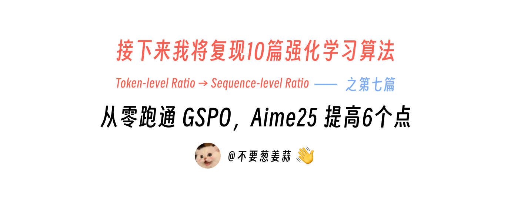
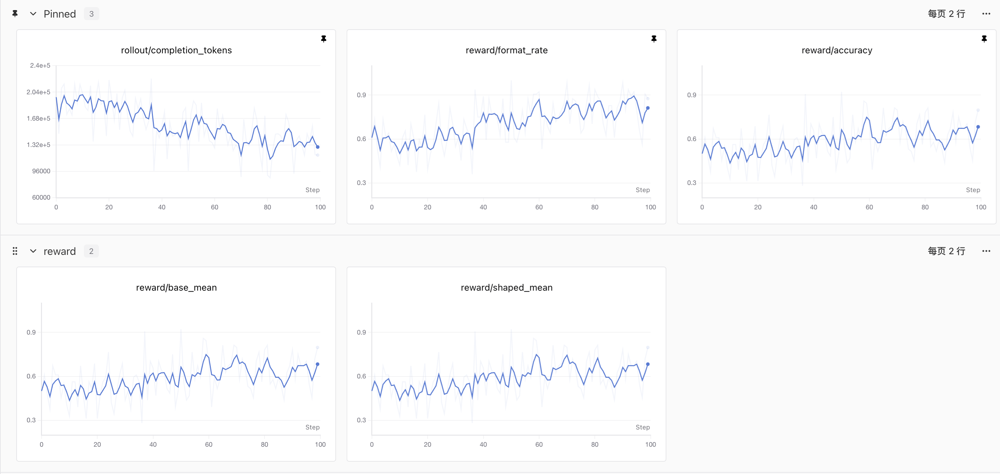
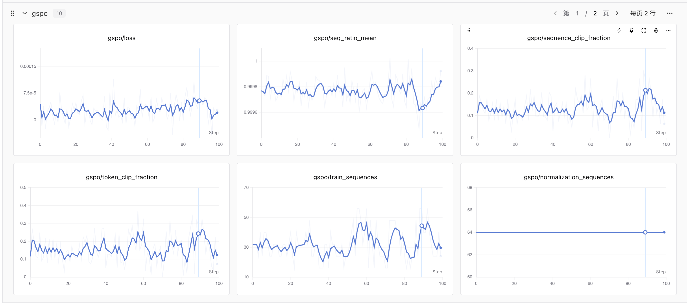
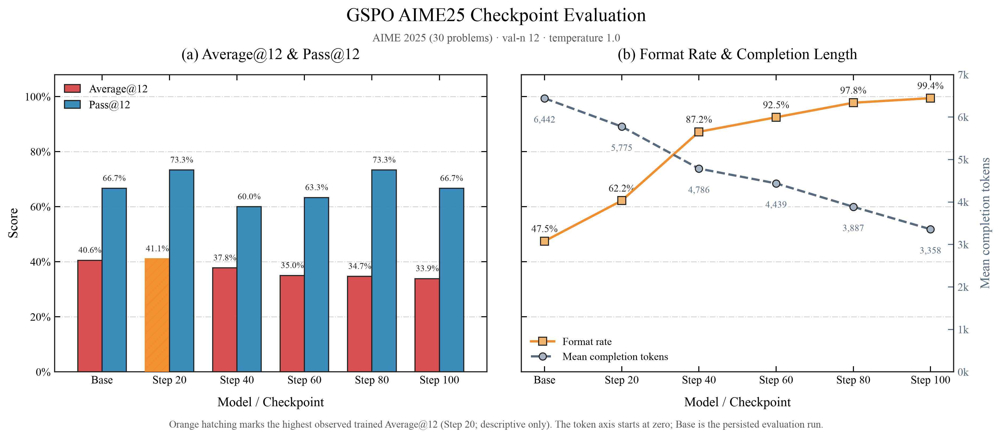

# 接下来我将复现 10 篇强化学习算法：第 7 篇，从零跑通GSPO，Aime25 提高6个点

> 想跳过正文直接运行？请查看 [快速启动指南](./start.md)：准备数据 → 训练 → 评测。



<div align="center">
  <a href="https://www.zhihu.com/people/feng-qi-xia-pian" target="_blank"></a>
  <a href="https://www.xiaohongshu.com/user/profile/63c2055e000000002502c58c" target="_blank"></a>
  <a href="https://github.com/datawhalechina/agentic-rl-lab"></a>
</div>

> **本地 GPU 版说明**
>
> 本章是 Datawhale [开源原教程](https://github.com/datawhalechina/agentic-rl-lab)的本地 GPU 版本。代码通过 [localtrio](../../docs/content/guide/localtrio.md)（与 PyTRIO 同名同参的本地替代库：训练用 transformers + PEFT LoRA，采样用 vLLM）在你自己的 NVIDIA 显卡上运行：默认 GPU 0 训练 LoRA，其余卡各跑一个 vLLM 采样副本；只有 1 张卡时两者共用。本章最少 1 张 48GB 卡或 2 张 24GB 卡，卡多只是采样更快（见下文“本地资源估算”）。不需要 `trio login`、API Key，也没有计费。
>
> 文中“复现结果”一节的表格、曲线和评测数字都是**原文在 PyTRIO 上的结果**；本地的硬件、采样引擎和数值精度都不同，且默认不训练输出层 `lm_head`（见“复现结果”一节的实现差异说明），复现数值可能有差异。感谢原作者 KMnO4-zx 与 Datawhale 社区的开源工作，原文与原版代码见 [Datawhale 原教程仓库](https://github.com/datawhalechina/agentic-rl-lab)。

> **代码与复现资源**
>
> - 本文完整代码：本目录下的 [`train.py`](./train.py)、[`loss.py`](./loss.py)、[`rollout.py`](./rollout.py)、[`eval.py`](./eval.py) 等，运行方式见 [快速启动指南](./start.md)
> - GSPO 论文：[Group Sequence Policy Optimization](https://arxiv.org/abs/2507.18071)
> - SwanLab：[原文 100-step 完整训练记录（PyTRIO）](https://swanlab.cn/@kmno4/llm-agent-rl-lab-gspo/runs/o83z2ghp/chart)
> - localtrio 指南：[原理与 API 对照](../../docs/content/guide/localtrio.md) · [显存与 GPU 布局规划](../../docs/content/guide/hardware.md)

这是“接下来我将复现 10 篇强化学习算法”系列的第七篇。

前面复现 [DAPO](../dapo/readme.md) 时，我们在 GRPO 的骨架上加入了 Dynamic Sampling、Clip-Higher、Token Mean 和 Soft Overlong Punishment。GSPO 的改动更集中：**沿用 group rollout、reward 和 group-relative advantage，只把 policy loss 里的重要性比率与裁剪从 token 级提升到 sequence 级。**

原文作者用 PyTRIO 在 `Qwen/Qwen3.5-4B` 上完成了 100 steps LoRA 训练，并评测 Base Model 与 Step 20、40、60、80、100 五个 checkpoint。本地版用同一套代码，通过 localtrio 在自己的显卡上训练与评测：GPU 0 做 LoRA 训练，其余卡上的 vLLM 负责 rollout 和评测采样（只有 1 张卡时两者共用）。先来看算法，再看原文的结果。


## GSPO 是什么？

GSPO 的全称是 **Group Sequence Policy Optimization**，由 Qwen 团队在 2025 年提出。它对同一道题采样一组回答，用组内 reward 的相对高低计算 advantage，从而省掉单独的 value model。GSPO 保留了这套 group-relative advantage，核心变化落在 loss：


> **GRPO：一条回答有 T 个 ratio、T 次 clipping；GSPO：一条回答只有 1 个 ratio、1 次 clipping。**

| 环节 | GRPO | GSPO |
| --- | --- | --- |
| Group rollout | 同一个 prompt 采样 $G$ 条回答 | 相同 |
| Reward | 每条完整回答得到一个 reward | 相同 |
| Advantage | 组内标准化，每条回答一个 $\hat A_i$ | 相同 |
| 重要性比率 | 每个 token 一个 $w_{i,t}$ | 每条回答一个 $s_i$ |
| Clipping | 逐 token 判断 keep / clip | 整条回答只判断一次 |
| Loss | 先聚合 token objective | 直接聚合 sequence objective |

GRPO 对回答中的每个 token 分别计算新旧策略概率比：

```math
w_{i,t}(\theta)=
\frac{
  \pi_\theta\left(y_{i,t}\mid x,y_{i,\lt t}\right)
}{
  \pi_{\theta_{\mathrm{old}}}\left(y_{i,t}\mid x,y_{i,\lt t}\right)
}
```

一条包含 $T$ 个 token 的回答会产生 $T$ 个 ratio，也会做 $T$ 次 clipping 判断。

GSPO 先把整条回答的 token log-ratio 求均值，再取指数：

```math
s_i(\theta)=
\exp\left(
\frac{1}{|y_i|}
\sum_{t=1}^{|y_i|}
\log
\frac{
  \pi_\theta\left(y_{i,t}\mid x,y_{i,\lt t}\right)
}{
  \pi_{\theta_{\mathrm{old}}}\left(y_{i,t}\mid x,y_{i,\lt t}\right)
}
\right)
```

这里的 $1/|y_i|$ 是长度归一化。它让不同长度回答的 ratio 落在相近的数值范围内。随后，整条回答共享同一个 ratio 和 clipping 结果：

```math
\mathcal{J}_{\mathrm{GSPO}}(\theta)
=
\frac{1}{G}\sum_{i=1}^{G}
\min\left(
s_i\hat{A}_i,\,
\mathrm{clip}\left(
  s_i,\,
  1-\varepsilon_{\mathrm{low}},\,
  1+\varepsilon_{\mathrm{high}}
\right)\hat{A}_i
\right)
```

论文给出的 GSPO 裁剪范围是：

```text
epsilon_low  = 3e-4
epsilon_high = 4e-4
```

这个范围看起来比常见的 GRPO clip 小很多，因为两者约束的量不同。GRPO 约束单个 token 的概率比，GSPO 约束经过长度归一化的整条 sequence ratio。

论文认为，reward 本来就是按完整回答给出的，sequence-level ratio 可以让 reward、重要性采样和优化目标处在同一个粒度上，并减少长序列里逐 token ratio 带来的高方差噪声。

本项目的数学 reward 使用 `math_verify` 判定最终答案，正确为 `1`、错误为 `0`。同组 reward 会进一步标准化为：

```math
\hat{A}_i =
\frac{
  r_i-\mathrm{mean}(r)
}{
  \mathrm{std}(r)+10^{-8}
}
```

组内全对或全错时，所有 advantage 都是 0。本文按 GSPO 的基础目标实现，没有再叠加 Dynamic Sampling，也不会补采新题；训练侧跳过这些没有梯度的序列，同时把它们的零目标保留在原始 loss 分母中。

## 复现结果（原文在 PyTRIO 上的结果）

本节的配置、曲线和评测数字都来自原作者在 PyTRIO 上的正式实验。本地版沿用同一组超参数，可以按 [快速启动指南](./start.md) 复现，但数值可能不同。

正式训练使用下面这组配置：

| 项目 | 配置 |
| --- | --- |
| Base Model | `Qwen/Qwen3.5-4B` |
| LoRA rank | 32 |
| 训练数据 | DAPO-Math，清洗后 17,126 道训练题 |
| 训练步数 | 100 steps |
| 每个 step | 8 个 prompt groups |
| 每个 group | 8 条 completions |
| 单步 rollout | 64 条 completions |
| 最大 prompt / completion | 2,048 / 4,096 tokens |
| Sampling | temperature 1.0 / top-p 1.0 / top-k -1 |
| Optimizer | Adam，lr `4e-5`，β `(0.9, 0.95)` |
| Checkpoint | 每 20 steps 保存一次 |

原文这次正式训练在 SwanLab 上记录了完整 100 steps，在 PyTRIO 上平均每步约 85 秒，总时长约 2 小时 22 分钟。下面两张图分别是 rollout/reward 和 GSPO loss 指标（原文在 PyTRIO 上的结果）：





训练过程中，`normalization_sequences` 固定为每步原始的 64 条回答，`train_sequences` 会随退化组数量变化。100 steps 的平均 sequence clip fraction 为 13.11%，最后一步为 6.25%。完整配置和每一步曲线可以直接在 [原文 SwanLab 训练记录](https://swanlab.cn/@kmno4/llm-agent-rl-lab-gspo/runs/o83z2ghp/chart) 中查看。

> **本地复现时看 clip fraction 要注意什么？**
>
> 这份实现每个 rollout batch 只做一次更新，理论上更新前的 sequence ratio 应该严格等于 1；实际不等于 1，主要来自“采样引擎算出的 logprob”和“训练引擎算出的 logprob”之间的数值差异。本地版中前者来自 vLLM（返回未经 temperature/top-p 处理的原始模型分布），后者来自 transformers 的 bf16 前向，两套 kernel 不同。GSPO 的裁剪区间只有 `[1 - 3e-4, 1 + 4e-4]`，长度归一化后的平均 log-ratio 只要超出约 `[-3e-4, 4e-4]` 就会落到裁剪区间外（是否真正截断梯度还取决于 advantage 的符号），所以本地的 `gspo/sequence_clip_fraction` 和 `gspo/seq_ratio_mean` 很可能与原文的 13.11% 不同，它们首先反映的是本地训推之间的数值差异，而不是策略变化。

> **与原文的一处实现差异：** `train.py` 调用 `create_lora_training_client` 时没有传 `train_unembed`，PyTRIO 默认 `train_unembed=True`，原文在 PyTRIO 上还训练了输出层 `lm_head`。localtrio 默认忽略这一项，只在语言模型的全部线性层（`trainer.lora_target_modules: all-linear`）上加 LoRA，本地结果可能因此与原文不同。想尽量对齐，可在 localtrio 配置里设 `trainer.allow_unembed: true`（以 LoRA 形式训练 `lm_head`），前提是你的 vLLM 能为这个模型加载带 `lm_head` 的 adapter，详见 [localtrio 说明](../../docs/content/guide/localtrio.md)。

### AIME25 评测

Base Model 和所有 checkpoint 都使用相同的评测配置：

```text
30 道 AIME25
每题采样 12 次，共 360 条 generations
temperature = 1.0
top_p = 1.0
top_k = -1
max_tokens = 8192
```

其中：

- **Average@12**：360 条 generation 中答对的比例；
- **Pass@12**：30 道题中，至少有一次采样答对的题目比例；
- **Format**：回答中成功提取到 `\boxed{}` 的比例。

完整结果如下：

| Checkpoint | Average@12 | Pass@12 | Format | 正确回答 | 通过题目 | 平均 completion tokens |
| --- | ---: | ---: | ---: | ---: | ---: | ---: |
| Base (Run 1) | 41.11% | 56.67% | 46.67% | 148/360 | 17/30 | 6489.8 |
| Base (Run 2) | 40.56% | 66.67% | 47.50% | 146/360 | 20/30 | 6442.5 |
| Step 20 | 41.11% | 73.33% | 62.22% | 148/360 | 22/30 | 5775.4 |
| Step 40 | 37.78% | 60.00% | 87.22% | 136/360 | 18/30 | 4785.8 |
| Step 60 | 35.00% | 63.33% | 92.50% | 126/360 | 19/30 | 4438.7 |
| Step 80 | 34.72% | 73.33% | 97.78% | 125/360 | 22/30 | 3886.9 |
| Step 100 | 33.89% | 66.67% | 99.44% | 122/360 | 20/30 | 3358.1 |



封面里的“AIME25 提高 6 个点”，具体指 **Step 20 的 Pass@12 相比 Base Run 2 从 66.67% 提升到 73.33%，增加 6.66 个百分点**。

这组结果还能看到三个更重要的现象：

1. Step 20 的 Average@12 为 41.11%，落在两次 Base 评测的波动范围内；正确回答数也和 Base Run 1 相同，都是 148/360。
2. 两次独立 Base 的 Pass@12 相差 10 个百分点。AIME25 只有 30 道题，单次 Pass@12 很容易受采样波动影响，因此 +6.66 个百分点还需要更多重复评测和随机种子确认。
3. Format 从 47.50% 持续上升到 99.44%，平均 completion tokens 从 6442.5 持续下降到 3358.1，缩短约 48%。Step 20 以后 Average@12 则逐步下降。

所以，这次实验最扎实的结论是：**GSPO 训练明显改变了模型的输出行为，格式遵循率大幅提高，回答长度持续缩短；当前数据还不能证明数学准确率获得了稳定提升。** 不同指标对应的最佳 checkpoint 也不同：Step 20 的 Average@12 最好，Step 20 和 Step 80 的 Pass@12 最高，Step 100 的格式率最高。

这里还缺少一组同模型、同数据、同训练预算的 GRPO 对照实验，因此本文也不拿这组结果证明 GSPO 优于 GRPO。

> **复现边界**
>
> GSPO 原论文使用从 `Qwen3-30B-A3B-Base` 微调得到的冷启动模型，并把一个 rollout batch 切成 4 个 optimizer mini-batch；论文报告的是 AIME 2024、LiveCodeBench 和 CodeForces。本文使用 Qwen3.5-4B LoRA、每个 rollout batch 一次更新和 AIME25，复现的是 GSPO 的核心 loss 与训练链路，不等同于论文规模实验，也没有验证论文中的 MoE 稳定性结论。仅复现论文核心算法思路和训练链路，评测结果仅供参考。

## 本地资源估算（估算，未实测）

本地版没有计费，换成看 GPU 占用和时间。不需要 4 张卡：本章只用一个基模（`Qwen/Qwen3.5-4B`），不写配置文件时 localtrio 按检测到的卡数分配，GPU 0 训练，其余卡各一个 vLLM 采样副本，只有 1 张卡时两者共用。最低与推荐配置（详见 [显存与 GPU 布局规划](../../docs/content/guide/hardware.md)）：

| 你的卡 | 怎么跑 | 速度（相对 4 卡，估算） |
| --- | --- | --- |
| 1 张 ≥48GB（最低） | 命令前加 `LOCALTRIO_CONFIG=configs/1gpu.yaml`（训练与采样共用 GPU 0，vLLM 占 40%） | 约 1/3～1/4 |
| 2 张 ≥24GB（最低） | 直接运行；24GB 卡加 `LOCALTRIO_CONFIG=configs/24gb.yaml`（训练 micro-batch 8192） | 约 1/2～1/3 |
| 4 张（推荐） | 直接运行，与 [`configs/4gpu.yaml`](../../configs/4gpu.yaml) 相同；3 张、8 张卡也直接运行 | 基准 |

表中路径按仓库根目录写；按下文在 `experiments/gspo` 下运行时写 `LOCALTRIO_CONFIG=../../configs/1gpu.yaml`。

24GB 卡上，vLLM 启动报 KV cache 不足时设置 `models.default.max_model_len: 16384`（训练需要 `max_prompt_tokens + max_tokens` = 6,144，AIME25 评测约 12,300）。

| GPU | 角色 | 显存（估算） |
| --- | --- | --- |
| GPU 0 | trainer：Qwen3.5-4B bf16 + LoRA rank 32 + AdamW，梯度检查点 | 基模权重（含视觉塔）约 9～10GB，LoRA 参数、梯度与 AdamW 状态约 1～2GB，加上激活常规约 15～25GB（micro-batch 16384；24GB 卡用 8192，约 13～18GB），其中 lm_head 计算 logprob 的分块在 `logits_chunk_size=1024` 时约 1～3GB，与 micro-batch 里有多少条序列无关（OOM 的处理见快速启动的常见问题） |
| 其余每张卡 | 各一个 vLLM 采样副本（data parallel），每步热加载最新 LoRA | 按 `gpu_memory_utilization=0.85` 预分配每卡 85%（权重 + KV cache）：48GB 卡约 40GB，24GB 卡约 20GB |

时间的数量级以 4 张 48GB 卡为例推算（正式配置：每步 8 组 × 8 条，completion 上限 4,096）：

- **rollout**：每步 8 个 group 请求分散到 3 个 vLLM 副本上，一次采齐、不补采，耗时由最长的那条 completion 决定。按显存带宽约 768GB/s 估算（带宽更高的卡解码更快），4B 模型 bf16 每解码一步要读一遍约 8～9GB 权重，按单条序列 40～60 token/s 估计，一个有回答跑满 4,096 token 的 step 约需 1～2 分钟。
- **训练**：`forward_backward_custom` 约等于 1 次无梯度前向 + 1 次带梯度的前向和反向（含梯度检查点重算），约 8 × 参数量 FLOPs/token，4B 模型约 32 GFLOP/token。退化组不进入训练，若每步约 10 万～20 万 completion token 进入 loss，约 3～6 PFLOP，按 bf16 实际 40～60 TFLOPS 估计约 1～2.5 分钟。
- **合计**：每步约 2.5～5 分钟，100 steps 约 4～8 小时；每次 AIME25 评测（360 条、上限 8,192 token）约 10～20 分钟。均不含首次下载模型和启动 vLLM 的时间。
- **卡更少时**：2 张卡只有 1 个采样副本，通用估算约慢 2～3 倍；rollout 时长主要由最长那条回答决定、训练时间不变，实际差距可能小一些。

以上都是按硬件参数推算的数量级，不是实测值；没有安装 `--extra kernels` 时，Qwen3.5 线性注意力的训练会明显变慢。实际耗时以 SwanLab 里的 `time/step_seconds` 为准，更完整的显存规划见 [显存与 GPU 布局规划](../../docs/content/guide/hardware.md)。

## 如何启动训练

本地版要求 Python `>=3.12`，依赖由仓库根目录的 `pyproject.toml` 管理（含 torch、transformers、peft、vllm），不需要登录任何训练服务：

```bash
# 在仓库根目录
uv sync --extra kernels            # kernels：Qwen3.5 线性注意力的训练加速 kernel，推荐安装
uv run python -m localtrio info    # 确认 GPU 布局：默认 GPU 0 训练，其余卡采样（单卡时共用）
uv run swanlab login               # 可选；不用 SwanLab 时训练命令加 --swanlab-mode disabled
```

准备 DAPO-Math 训练集和 AIME25：

```bash
uv run python experiments/gspo/prepare_data.py
```

启动与本文正式实验相同的 100-step 训练：

```bash
cd experiments/gspo

uv run python train.py \
    --max-steps 100 \
    --groups-per-step 8 \
    --group-size 8 \
    --max-prompt-tokens 2048 \
    --max-tokens 4096
```

`LOCALTRIO_CONFIG` 的相对路径按当前目录解析：在 `experiments/gspo` 下要切换 GPU 布局时写 `LOCALTRIO_CONFIG=../../configs/xxx.yaml`（例如 1 张 48GB 卡用 `1gpu.yaml`，24GB 卡用 `24gb.yaml`；在仓库根目录则写 `configs/xxx.yaml`，也可以用绝对路径）。

三个角色分别跑在不同的地方：主进程（普通 Python）负责数据、reward、GSPO loss 和训练流程控制；localtrio 的 trainer 子进程在 GPU 0 上执行 LoRA 前向与反向、优化器更新和 checkpoint 保存；其余卡上的 vLLM 副本负责采样（单卡时与 trainer 共用 GPU 0），每个 step 按路径热加载最新的 LoRA。checkpoint 是 `~/.cache/localtrio/runs/<run_id>/` 下的普通目录，训练日志里的 `Saved sampler weights:` 会打印完整路径。

## 我们是怎么复现的？

整条训练链路可以先看这张图。图里用当前默认的 4 个 prompt groups 做示意；上面的正式实验通过命令行把它改成了 8。图中蓝色的 “PYTRIO SERVICE” 在本地版对应 localtrio 的 trainer（GPU 0）和 vLLM 采样副本（其余卡）。


### 1. 准备并固定数学数据

[`prepare_data.py`](./prepare_data.py) 下载固定 revision 的 DAPO-Math-17K，清洗 prompt、去重并切分 train/dev，同时单独下载并校验 30 道 AIME25。

[`data.py`](./data.py) 负责读取训练 JSONL、按 seed 打乱，以及用可回绕的 `ExampleCursor` 按 step 取题。当前实现没有 Dynamic Sampling，所以每个 step 固定取一批 prompt，一次采齐。

### 2. Group rollout、0/1 reward 与 advantage

[`rollout.py`](./rollout.py) 先用 Qwen chat template 构造 prompt，再通过当前 LoRA 权重对应的 sampler（本地 vLLM 热加载 LoRA）为每道题并发采样 8 条回答。每条回答都会保存：

```text
completion tokens
sampling logprobs
decoded text
reward
advantage
```

token 与 sampling logprob 的长度会被严格校验，因为它们稍后需要逐 token 对齐计算 sequence ratio。

[`reward.py`](./reward.py) 从回答中提取最后一个完整的 `\boxed{}`，再用 `math_verify` 判断它与参考答案是否等价。答对得 1，答错或格式缺失得 0。它没有长度惩罚，也没有额外的 format reward。

rollout 完成后，同一道题的 8 个 reward 会计算组内均值和样本标准差，得到每条回答共享的 sequence advantage。全对或全错的组 advantage 为 0，不会送进 trainer 做无效计算。

### 3. 构造 Datum，并在本地计算 GSPO loss

[`loss.py`](./loss.py) 是这次复现的核心。

`build_datum()` 把 prompt 和 completion 做自回归右移：

```text
model_input   = prompt_tokens + completion_tokens[:-1]
target_tokens = [0] * (len(prompt_tokens) - 1) + completion_tokens
```

`Datum.loss_fn_inputs` 保存 `target_tokens`，本地 `GSPOMeta` 保存 rollout 时的 `sampling_logprobs`、sequence advantage 和 completion 长度。

随后，`forward_backward_custom()` 先在 trainer 上做一次前向，把当前策略在这些 target token 上的 logprob 作为可求导张量交给主进程里的 `make_gspo_loss_fn()`。它取出 completion 区间，完成三步计算：

```text
current logprobs - sampling logprobs
        ↓
mean token log-ratio → exp → one sequence ratio
        ↓
one sequence-level clipping decision
```

每条 sequence 等权求和，再除以原始 rollout 的 sequence 数。退化组虽然没有送进 trainer 计算，它们原本为 0 的 objective 仍然留在分母里，因此过滤只节省计算，不会放大剩余样本的 loss。

loss 算完后，localtrio 在主进程里用 autograd 求出 `dL/dlogprob`，再让 trainer 以 `sum(g · logprob)` 为代理目标反传到 LoRA。在 localtrio 的默认设置（`trainer.custom_loss_normalization: none`）下，这样得到的参数梯度严格等于 GSPO loss 的梯度，不会再额外除以 token 数，所以“custom loss 自己处理分母”这一点在本地版成立，上面的 `normalization_sequences` 就是最终的分母。

> 原版 PyTRIO 0.2.9 的 SDK 会把 custom loss 换成 `weights = -dL/dlogprob` 的 `cross_entropy` 再提交一次，并把梯度非 0 的 token 数作为 logical batch 的分母信息发给服务端，SDK 注释只保证参数梯度的方向相同。所以原文在 PyTRIO 上的实际梯度可能还多除了这个随 step 变化的 token 数。这个 token 数只统计真正产生梯度的样本，因此“退化组留在分母里、过滤不放大剩余样本”的设计只在 localtrio 默认的尺度下严格成立。本章用 Adam、没有开 `grad_clip_norm`，整体尺度对更新的影响不大。想按 SDK 的口径训练，可在 localtrio 配置里设 `trainer.custom_loss_normalization: same_as_builtin`，此时分母沿用内置 loss 的 `trainer.loss_normalization`，默认的 `active_tokens` 下就是梯度非 0 的 token 数。

### 4. 一个 rollout batch 对应一次更新

[`train.py`](./train.py) 把上面的模块串起来：

```text
加载并打乱数据
→ 创建 LoRA TrainingClient，并在训练开始时获取一次 tokenizer
→ 每 step 用最新 LoRA 权重创建 sampler
→ 并发 group rollout
→ 过滤 advantage 为 0 的退化组
→ forward_backward_custom
→ optim_step
→ 记录 SwanLab，并按周期保存 checkpoint
```

应用侧没有再拆 mini-batch。一个 rollout batch 只调用一次 backward 和一次 `optim_step`；本地的 trainer 会按 `trainer.max_tokens_per_microbatch`（默认 16,384 token）把这一批切成若干 micro-batch 依次反传、累积梯度，结果等价于整批计算。显存不够时调小这个值即可，不需要改训练代码。

### 5. 评测并生成结果图

[`eval.py`](./eval.py) 可以评测 Base Model，也可以读取本地 sampler weights 目录评测任意 checkpoint。它会保存每道题的 12 条完整回答，并聚合 Average@12、Pass@12、Format 和平均 completion tokens。评测只启动 vLLM，不加载 trainer，训练结束后可以用 `LOCALTRIO_SAMPLER_GPUS` 把所有卡都列给采样（例如 4 张卡写 `0,1,2,3`）。

[`analyse.py`](./analyse.py) 自动读取 `eval-results/` 中的 summary，按 checkpoint 排序，生成 1×2 AIME25 结果图。本地版默认把图写到 `eval-results/aime25-gspo-progress.png`，不会覆盖本文引用的原文结果图。

八个代码文件的职责可以汇总为：

| 文件 | 模块职责 |
| --- | --- |
| [`prepare_data.py`](./prepare_data.py) | 下载、清洗、去重并固定 DAPO-Math 与 AIME25 |
| [`data.py`](./data.py) | 读取训练题、固定 seed 打乱、循环取样 |
| [`reward.py`](./reward.py) | 提取 `\boxed{}`、数学等价判断、0/1 reward |
| [`rollout.py`](./rollout.py) | Prompt、并发 group rollout、token/logprob 对齐、advantage |
| [`loss.py`](./loss.py) | Datum、GSPO 元数据、sequence ratio 与 clipping loss |
| [`train.py`](./train.py) | 训练主循环、localtrio 调用、SwanLab 与 checkpoint |
| [`eval.py`](./eval.py) | Base/LoRA AIME25 评测与 JSONL 结果 |
| [`analyse.py`](./analyse.py) | 汇总 checkpoint 指标并绘制结果图 |

## 总结

GSPO 的思路很直接：保留 GRPO 的 group rollout、reward 和 relative advantage，把重要性比率与 clipping 的单位从 token 改成完整 sequence。原文用 PyTRIO 跑通了这条 custom loss 训练链路，也完成了 Base + 5 个 checkpoint 的 AIME25 评测：Step 20 的单次 Pass@12 提高了 6.66 个百分点，格式遵循率和回答长度的变化更加稳定；数学准确率是否能持续提升，还需要 matched GRPO、更多随机种子和重复评测来回答。

本地版保留了同一套代码和超参数（输出层 `lm_head` 默认不训练，见上文的实现差异说明），把训练与采样换成 localtrio 在自己的显卡上执行。在本地复现时，除了 AIME25 指标，也建议对照 `gspo/seq_ratio_mean` 和 `gspo/sequence_clip_fraction`，确认训推数值差异没有让大部分序列在第一次更新前就被裁剪。

## 参考资料

1. Chujie Zheng et al. [Group Sequence Policy Optimization](https://arxiv.org/abs/2507.18071), 2025.
2. 本地版代码与运行方式：本目录的 [`train.py`](./train.py)、[`loss.py`](./loss.py) 与 [快速启动指南](./start.md)
3. [localtrio 原理与 API 对照](../../docs/content/guide/localtrio.md) · [显存与 GPU 布局规划](../../docs/content/guide/hardware.md)
4. 原版（PyTRIO）完整代码：[Datawhale 原教程 · experiments/gspo](https://github.com/datawhalechina/agentic-rl-lab/tree/main/experiments/gspo)
5. 原版使用的 [PyTRIO 文档](https://docs.pytrio.com/docs)
6. [原文 SwanLab 训练记录](https://swanlab.cn/@kmno4/llm-agent-rl-lab-gspo/runs/o83z2ghp/chart)
